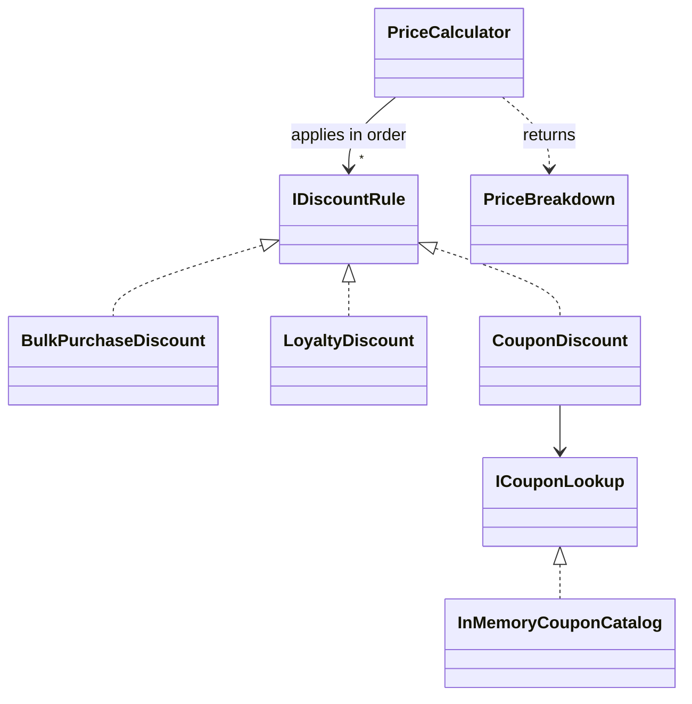

# 01 — SOLID Principles: Checkout Pricing

Price an order for a small web shop (subtotal, stackable discount rules, a price breakdown) with a design where each SOLID principle has a concrete, testable place.

- Date: 2026-10-07
- Status: Implemented. Written before any code; notes marked *After the refactor* record what refactoring changed (details in [REFACTOR-NOTES.md](REFACTOR-NOTES.md)).
- Living spec: [openspec/specs/checkout-pricing/spec.md](../../openspec/specs/checkout-pricing/spec.md) (OpenSpec, since 2026-10-08). From then on this document is a frozen record of the pre-code spec; behaviour changes go to the living spec.

## 1. The concept

SOLID is a set of five object-oriented design principles. Their common goal is code that is cheap to change.

- **S, Single Responsibility.** A class has one reason to change: it serves one policy or one group of people. Two policies that change for different reasons (loyalty rates and coupon terms, for example) belong in different classes.
- **O, Open/Closed.** New behaviour is added by writing new code, not by editing code that already works. This requires an abstraction at the point where the variation happens.
- **L, Liskov Substitution.** Every implementation of an abstraction honours the abstraction's contract, so callers can use any implementation without special cases. The contract is more than the method signature: it includes value ranges, rounding and the absence of side effects.
- **I, Interface Segregation.** A client depends only on the members it uses. Interfaces are shaped by what their clients need, not by everything an implementation can do.
- **D, Dependency Inversion.** High-level policy depends on abstractions. Details (concrete rules, storage) implement those abstractions and are handed in from outside.

**The problem it solves.** Without these principles, business logic collects in one method full of conditionals. Every new requirement edits that method, unrelated policies break each other, and the method cannot be tested without its real dependencies.

**Costs and trade-offs.** More types and more indirection: one price calculation is spread over a dozen small files, which is harder to follow when reading. Every abstraction is a bet on how the code will change. When the bet is wrong (a new rule needs data the interface does not provide), the abstraction becomes the expensive part to change.

**When not to use it.** Scripts, prototypes, and logic with one stable implementation. A single method with an `if` is clearer until a second variation actually appears; introduce the abstraction when the axis of change is real (the second promotion, not the first). SOLID applied dogmatically to tiny code is over-engineering.

## 2. Problem statement

A small web shop prices orders at checkout. The marketing team changes discount policies often: bulk discounts, loyalty tiers, coupons and short-lived promotions. If all of them lived in one checkout method, every promotion would mean editing and re-testing that method. The shop needs a pricing component where:

- each discount policy is independent and can be tested on its own;
- a new policy can be added without editing the existing policies or the code that combines them;
- the result explains every discount to the customer, and the total can never go below zero.

## 3. Scope

**In scope**

- Order model: lines (SKU, unit price, quantity), customer tier, optional coupon code.
- Subtotal, three built-in discount rules (bulk purchase, loyalty, coupon), stacking, and a cap on the total discount.
- A read-only, in-memory coupon catalog.
- A price breakdown that lists every applied discount.

**Out of scope**

- Taxes, shipping and multiple currencies (one currency, 2 decimals).
- Persistence and coupon administration (creating, expiring, counting redemptions).
- Rule exclusivity or priorities, such as "coupon not combinable with loyalty".
- Validation of order input (see §7), UI and HTTP API.

## 4. Requirements

| ID | Requirement |
|----|-------------|
| FR-1 | `LineTotal = UnitPrice × Quantity`. `Subtotal` is the sum of the line totals; an order without lines has a subtotal of 0.00. |
| FR-2 | `PriceCalculator` applies every registered rule to the order, in registration order. Each rule sees the original order: discounts add up, they do not compound. |
| FR-3 | A rule returns 0.00 when it does not apply. Only amounts greater than zero are listed in the breakdown, as (rule name, amount), in registration order. |
| FR-4 | `TotalDiscount = min(sum of listed amounts, Subtotal)` and `Total = Subtotal − TotalDiscount`, so the total is never negative. Listed amounts stay as each rule computed them; only the total discount is capped. |
| FR-5 | **Bulk purchase** (name `Bulk purchase`): 10% of the line total of every line with `Quantity ≥ 10`. |
| FR-6 | **Loyalty** (name `Loyalty`): a percentage of the subtotal by customer tier: Standard 0%, Silver 3%, Gold 5%. |
| FR-7 | **Coupon** (name `Coupon`): if the order has a coupon code, the code exists in the catalog and `Subtotal ≥ MinimumSubtotal`, the discount is `min(Amount, Subtotal)`; otherwise 0.00. |
| FR-8 | The coupon catalog is created from a list of coupons and finds a code ignoring letter case; an unknown code finds no coupon. |
| FR-9 | Money is `decimal`. A computed amount (a percentage of something) is rounded to 2 decimals with `MidpointRounding.AwayFromZero`. |
| FR-10 | The discount contract, honoured by every rule: `0 ≤ amount ≤ order.Subtotal`, at most 2 decimals, and no side effects (the same order always gives the same amount). |

Business numbers at a glance: bulk threshold 10 units, bulk rate 10%; loyalty Silver 3%, Gold 5%; example coupon `SAVE5` = 5.00 off with a minimum subtotal of 50.00.

## 5. Design

### Public API (namespace `Checkout`)

```csharp
public enum CustomerTier { Standard, Silver, Gold }

public sealed record OrderLine(string Sku, decimal UnitPrice, int Quantity)
{ public decimal LineTotal { get; } }

public sealed record Order(IReadOnlyList<OrderLine> Lines,
    CustomerTier Tier = CustomerTier.Standard, string? CouponCode = null)
{ public decimal Subtotal { get; } }

public interface IDiscountRule                    // contract: FR-10
{
    string Name { get; }
    decimal CalculateDiscount(Order order);
}

public sealed class BulkPurchaseDiscount : IDiscountRule;                  // FR-5
public sealed class LoyaltyDiscount : IDiscountRule;                       // FR-6
public sealed class CouponDiscount(ICouponLookup coupons) : IDiscountRule; // FR-7

public interface ICouponLookup { Coupon? Find(string code); }
public sealed record Coupon(string Code, decimal Amount, decimal MinimumSubtotal);
public sealed class InMemoryCouponCatalog(IEnumerable<Coupon> coupons) : ICouponLookup;

public sealed record AppliedDiscount(string RuleName, decimal Amount);
public sealed record PriceBreakdown(decimal Subtotal,
    IReadOnlyList<AppliedDiscount> Discounts, decimal TotalDiscount, decimal Total);

public sealed class PriceCalculator(IEnumerable<IDiscountRule> rules)
{ public PriceBreakdown Calculate(Order order); }
```

*After the refactor:* `PriceBreakdown` is built from `(Subtotal, Discounts)` and derives `TotalDiscount` and `Total`; a new public `Money.Round(decimal)` owns the rounding policy; `LoyaltyDiscount` also has a constructor that takes the rate table (`IReadOnlyDictionary<CustomerTier, decimal>`), and its parameterless constructor keeps the FR-6 rates.

### How SOLID shapes the design

| Principle | Where | Why |
|-----------|-------|-----|
| S | `PriceCalculator` only orchestrates: run the rules, collect the results, total them. Each rule class owns one pricing policy. `InMemoryCouponCatalog` owns the coupon data. *After the refactor:* `PriceBreakdown` owns the totals and `Money` owns rounding. | A change to loyalty rates touches one class, a change to coupon terms another, and neither touches the calculator. |
| O | `PriceCalculator` works with any `IDiscountRule`. | A new promotion is a new class registered by the caller; the calculator and the existing rules are not edited. Test 3 proves it with a rule from another assembly. |
| L | Every rule honours the FR-10 contract, and the calculator relies on it instead of validating each result. | The calculator treats all rules the same way. Test 4 runs every built-in rule against the same edge-case orders. |
| I | `CouponDiscount` depends on `ICouponLookup` (one read method), not on a coupon store that can also create or expire coupons. | The rule only reads. A narrow interface keeps its dependency minimal and trivial to replace in a test. |
| D | `PriceCalculator` receives `IEnumerable<IDiscountRule>`; `CouponDiscount` receives `ICouponLookup`. The caller decides which rules run, in which order, and where coupons come from. | Pricing policy does not depend on storage details: a database-backed catalog could replace the in-memory one without touching any rule. |



The same behaviour without SOLID fits in one method of about 30 lines with a switch on tier and an `if` per rule. That is the better choice for a shop whose discounts never change. This design earns its extra types only because the scenario says discounts change often.

## 6. Acceptance criteria → tests

| AC | Criterion | Test |
|----|-----------|------|
| AC-1 | When no rule applies (Standard tier, no line of 10 or more units, coupon missing, unknown or below its minimum), no discount is listed, `TotalDiscount` is 0.00 and `Total` equals `Subtotal`. Order: 9 × 1.50 + 1 × 25.00 = 38.50. | `Calculate_NoApplicableRules_TotalEqualsSubtotal` (3 rows: no code, `WELCOME10`, `SAVE5`) |
| AC-2 | Worked example: 10 × 2.00 + 1 × 80.00 = 100.00, Gold tier, coupon entered as `save5` (`SAVE5`: 5.00 off, minimum 50.00). Discounts listed in registration order: Loyalty 5.00, Bulk purchase 2.00 (10% of 20.00), Coupon 5.00. `TotalDiscount` 12.00, `Total` 88.00. | `Calculate_SeveralApplicableRules_StacksDiscountsAndListsEachOne` |
| AC-3 | A rule class defined outside the library (in the test project: 20% off `MUG` lines) is applied by the unchanged `PriceCalculator`. Order: 2 × 12.50 `MUG` + 1 × 30.00 = 55.00 → discount 5.00, total 50.00. | `Calculate_CustomRule_IsAppliedWithoutChangingTheCalculator` |
| AC-4 | Every built-in rule honours the FR-10 contract on each edge-case order: empty order, subtotal below the coupon minimum, coupon larger than the subtotal, bulk quantity, Gold tier. | `DiscountRules_AnyOrder_HonourTheDiscountContract` (3 rules × 5 orders) |
| AC-5 | When the listed discounts add up to more than the subtotal, `TotalDiscount` equals `Subtotal`, `Total` is 0.00 and the listed amounts are unchanged. Two stub rules (30.00 and 25.00) on a 40.00 order; each stays within the contract, only their sum exceeds the subtotal. | `Calculate_DiscountsExceedSubtotal_TotalDiscountIsCappedAndTotalIsZero` |

**Coverage notes.** AC-4 checks the contract, not exact amounts. Exact amounts are pinned by AC-2 (Gold 5%, bulk at exactly 10 units, coupon applied, case-insensitive code) and AC-1 (Standard 0%, 9 units, coupon missing, unknown or below its minimum). With a budget of five test methods, three details have no exact-value test: the Silver rate (3%), the midpoint rule (`AwayFromZero` rather than `ToEven`), and the coupon amount when the coupon exceeds the subtotal (AC-4 checks only the upper bound). They are candidates for later tests. *After implementation:* a mutation check confirmed that these three, and only these, go undetected ([REFACTOR-NOTES.md](REFACTOR-NOTES.md)).

## 7. Assumptions & decisions

- **Discounts add up and do not compound.** A rule receives the order, not a running total, so it cannot see other rules' results. The signature of `CalculateDiscount(Order)` enforces this; rule order only affects the order of the listing.
- **Each rule rounds its own result**, because only the rule knows its arithmetic. The calculator adds amounts that are already rounded and never rounds itself. *After the refactor:* rules round with `Money.Round`.
- **The cap lives where rules are combined.** Each rule stays at or below the subtotal on its own (contract), but only the calculator sees the combination, so it caps `TotalDiscount`. Listed amounts are not trimmed: the receipt shows what each rule granted, and the cap is visible as `TotalDiscount` being less than their sum. *After the refactor:* `PriceBreakdown` applies the cap by deriving `TotalDiscount` from the listed discounts, so no code can build an inconsistent breakdown.
- **The calculator trusts the contract.** It does not re-validate rule results at runtime; the contract test is the guard for the built-in rules.
- **Orders are assumed valid:** `Quantity ≥ 1`, `UnitPrice ≥ 0` with at most 2 decimals, coupon amounts with at most 2 decimals. Validation belongs where orders are created and is out of scope.
- **Coupon codes** are compared with an ordinal, case-insensitive comparison and are not trimmed (cleaning user input is the caller's job). Codes in one catalog are unique.
- **Rule names are display texts** shown to the customer: `Bulk purchase`, `Loyalty`, `Coupon`.
- **Null handling** is expressed with nullable reference types; there are no runtime null guards.
- **Tests use hand-written doubles**: a custom rule for AC-3 and a fixed-amount stub for AC-5. No mocking library.
