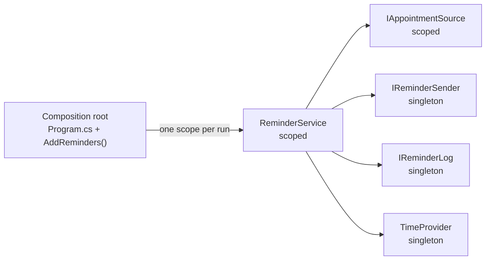

# 02 — Dependency Injection: Appointment Reminders

A clinic job that e-mails each patient one reminder for an appointment starting within the next 24 hours, built to show constructor injection, the composition root and service lifetimes.

- **Date:** 2026-10-07
- **Status:** Implemented. Written before any code; the only later changes are one corrected sentence in section 5.3 (when validation fails), after an experiment during the refactor step, and the living-spec line below.
- **Living spec:** [openspec/specs/appointment-reminders/spec.md](../../openspec/specs/appointment-reminders/spec.md) (OpenSpec, since 2026-10-08). From then on this document is a frozen record of the pre-code spec; behaviour changes go to the living spec.

## 1. The concept

**Dependency Injection (DI)** means a class receives the collaborators it needs from outside, normally through its constructor, instead of creating them itself or reaching for a global. The class states *what* it needs, usually as an abstraction; whoever constructs it decides *which* implementation it gets.

**The problem it solves.** A class that calls `DateTimeOffset.UtcNow`, opens its own database connection or creates its own mail client is welded to those choices. Its tests need a real clock, database and mail server, and changing the delivery channel means editing business logic. With DI the business class depends on abstractions: tests pass fakes, production passes real implementations, and the wiring lives in one place.

Ideas this project uses:

- **Constructor injection.** Dependencies are constructor parameters: explicit, required and visible in the signature. Once constructed, the object is complete.
- **Volatile vs. stable dependencies.** Inject what is non-deterministic or tied to the environment: the clock, a data store, a delivery channel, shared mutable state. Call stable, pure code (formatting, calculations) directly; an interface for it adds indirection with nothing to swap.
- **Composition root.** The object graph is assembled in one place at the application's entry point (`Program.cs`, helped by the library's `AddReminders()`). No business class creates its own services or touches the container.
- **The container is optional.** DI is a technique; `Microsoft.Extensions.DependencyInjection` only automates the wiring. Wiring by hand ("pure DI") is just as valid, and the test for AC-1 does exactly that.
- **Lifetimes.** *Singleton*: one instance per container. *Scoped*: one per scope (a web request; here, one job run). *Transient*: a new instance per resolution. A service must not depend on a shorter-lived one: a singleton that holds a scoped service keeps it alive for the whole process. This is a **captive dependency**, for example one `DbContext` shared by every run and thread.
- **Validation.** `ValidateOnBuild` builds the call site of every registration when the provider is created, so a missing registration fails at startup instead of in the middle of a run. `ValidateScopes` rejects captive dependencies and the resolution of scoped services from the root provider. Both are off for a plain `BuildServiceProvider()`; the Generic Host turns them on only in Development.
- **Service locator is an anti-pattern.** Injecting `IServiceProvider` into a business class and calling `GetService` inside it hides the real dependencies, defers failures to run time and forces tests to build a container. Only the composition root talks to the container.

**Costs and trade-offs.** More types (an interface per volatile dependency) and an extra hop when navigating code. Wiring mistakes surface at run time, not compile time (validation narrows the gap). Lifetime bugs are subtle. DI is easy to over-apply ("an interface for everything"). A constructor with many parameters is a design smell that DI makes visible but does not fix.

**When not to use it.** For stable, pure logic and value objects; for small scripts with no tests and no alternative implementations. And a container is unnecessary when wiring by hand stays short and clear.

## 2. Problem statement

The clinic wants fewer missed appointments. A job runs periodically (for example every 15 minutes). Each run must send a reminder for every appointment starting within the next 24 hours and must never remind the same appointment twice. The reminder logic has to be testable without a real clock, database or mail server, and the hosting application must be able to change the data source or delivery channel without editing that logic.

## 3. Scope

**In scope**

- `ReminderService`: one run of the reminder job.
- Abstractions for the four volatile dependencies (clock, appointment source, reminder sender, reminder log) with simple in-memory and console implementations.
- `AddReminders()`: default registrations with deliberate lifetimes.
- A console app acting as the composition root.

**Out of scope**

- Real e-mail or SMS delivery, a real database, persistence of the reminder log (it lives in memory and is lost on restart).
- Scheduling: a host would call the job from a timer or a `BackgroundService`; the demo calls it twice.
- Retries, time-zone-aware display (all times are shown in UTC), localisation.

## 4. Requirements

### Reminder job

- **FR-1 Due rule.** A run reads the clock once (`now`). An appointment is due when `now < StartsAt <= now + 24 hours`. Exactly 24 hours ahead is due; 24 hours and 1 minute ahead is not; an appointment that has already started (`StartsAt <= now`) is never due.
- **FR-2 One reminder each.** For every due appointment that has not been reminded before, the run sends exactly one reminder to `PatientEmail`, earliest appointment first.
- **FR-3 Message format.** Let `{start}` be `StartsAt` converted to UTC, formatted `yyyy-MM-dd HH:mm` with the invariant culture, followed by ` UTC`.
  - To: `{PatientEmail}`
  - Subject: `Appointment reminder: {start}`
  - Body: `Dear {PatientName}, this is a reminder of your appointment with {ClinicianName} on {start}.`
  - Example: `StartsAt = 2026-10-07 13:00 +02:00` gives the subject `Appointment reminder: 2026-10-07 11:00 UTC`.
- **FR-4 No duplicates.** After a reminder is sent, the appointment is recorded in the reminder log. A recorded appointment is never reminded again by a later run in the same process.
- **FR-5 Result.** A run returns the number of reminders it sent (0 when nothing is due).
- **FR-6 Failure.** If sending throws, the exception propagates. Reminders already sent in that run stay recorded; the failed and the remaining appointments are retried by the next run (at-least-once delivery).

### Composition

- **FR-7 Valid defaults.** `AddReminders()` alone registers a complete object graph (section 5.3) that passes `ValidateOnBuild` and `ValidateScopes`.
- **FR-8 Lifetimes.** All runs share one reminder log; each run (scope) gets its own `ReminderService`.
- **FR-9 Replaceable.** The host can replace the clock, the appointment source and the sender in its composition root; `ReminderService` does not change.
- **FR-10 Demo.** A console app wires everything with `AddReminders()`, seeds three appointments relative to the current time (two of them due), runs the job twice in separate scopes and prints how many reminders each run sent: 2, then 0.

## 5. Design

### 5.1 Public API (namespace `Reminders`)

```csharp
public sealed record Appointment(Guid Id, string PatientName, string PatientEmail, string ClinicianName, DateTimeOffset StartsAt);
public sealed record ReminderMessage(string To, string Subject, string Body);

public interface IAppointmentSource   // returns from < StartsAt <= to, ordered by StartsAt
{
    Task<IReadOnlyList<Appointment>> GetStartingBetweenAsync(DateTimeOffset from, DateTimeOffset to, CancellationToken cancellationToken);
}

public interface IReminderSender      // completes once the message is handed over; throws if it cannot be
{
    Task SendAsync(ReminderMessage message, CancellationToken cancellationToken);
}

public interface IReminderLog         // shared by all runs, so implementations must be thread-safe
{
    bool WasSent(Guid appointmentId);
    void MarkSent(Guid appointmentId);
}

public sealed class InMemoryAppointmentSource(IEnumerable<Appointment> appointments) : IAppointmentSource;
public sealed class ConsoleReminderSender(TextWriter writer) : IReminderSender;
public sealed class InMemoryReminderLog : IReminderLog;

public sealed class ReminderService(
    IAppointmentSource appointmentSource, IReminderSender reminderSender, IReminderLog reminderLog, TimeProvider timeProvider)
{
    public Task<int> SendDueRemindersAsync(CancellationToken cancellationToken = default);
}

public static class ServiceCollectionExtensions
{
    public static IServiceCollection AddReminders(this IServiceCollection services);
}
```

- `InMemoryAppointmentSource` is seeded through its constructor and keeps a snapshot of the appointments.
- `ConsoleReminderSender` writes one line per reminder: `To: {To} | Subject: {Subject} | Body: {Body}`.
- `InMemoryReminderLog` is a lock-protected set of appointment ids.

### 5.2 How DI shapes the design

- `ReminderService` receives all four volatile dependencies through its constructor. It never reads `DateTimeOffset.UtcNow`, never writes to `Console` and never sees the container, so a test can construct it with fakes in one line.
- The clock is the BCL's `TimeProvider` (.NET 8+), not a home-made `IClock`; tests subclass it and override `GetUtcNow()`.
- Message formatting (FR-3) is **not** injected. It is deterministic and has exactly one correct behaviour, so there is nothing to swap; tests check its output through `ReminderService`.
- `ConsoleReminderSender` depends on a `TextWriter`, not on `Console`: `AddReminders()` passes `Console.Out`, a test could pass a `StringWriter`.
- The library decides what *can* be wired (`AddReminders()`); the application decides what *is* wired (`Program.cs`) and may override any default.

### 5.3 Registrations and lifetimes

| Service | Default implementation | Lifetime | Reason |
|---|---|---|---|
| `TimeProvider` | `TimeProvider.System` | Singleton | Stateless and thread-safe. |
| `IReminderLog` | `InMemoryReminderLog` | Singleton | Its state must survive from one run (scope) to the next. |
| `IAppointmentSource` | `InMemoryAppointmentSource` with no appointments | Scoped | Stands in for a `DbContext`-backed source: one unit of work per run. The host registers the real source. |
| `IReminderSender` | `ConsoleReminderSender` on `Console.Out` | Singleton | Stateless; `Console.Out` is synchronised, so one instance can serve every run. |
| `ReminderService` | itself | Scoped | Depends on the scoped source; one instance per run. |

Dependencies point from shorter-lived to equally or longer-lived services, never the reverse. Registered as a singleton, `ReminderService` would capture the scoped source (a captive dependency). With `ValidateOnBuild` and `ValidateScopes` both on, the container refuses to build; with `ValidateScopes` alone it fails only when the service is first resolved.



## 6. Acceptance criteria → tests

| AC | Criterion | Test |
|---|---|---|
| AC-1 | Wired by hand without a container, one run reminds exactly the due appointments (FR-1), once each, earliest first, with the message of FR-3, and returns the count (FR-5). Boundaries: +24 h is due; +24 h 1 min, starting now and in the past are not. | `ReminderServiceTests.SendDueReminders_AppointmentsWithinNext24Hours_SendsOneReminderEach` |
| AC-2 | A second run one hour later, by a new `ReminderService` sharing the same log, sends nothing for an appointment the first run reminded (FR-4). | `ReminderServiceTests.SendDueReminders_RunTwice_DoesNotRemindTheSameAppointmentAgain` |
| AC-3 | `AddReminders()` alone builds with `ValidateOnBuild` and `ValidateScopes`, and `ReminderService` resolves in a scope (FR-7). | `ServiceCollectionExtensionsTests.AddReminders_BuildsAValidObjectGraph` |
| AC-4 | `IReminderLog` is the same instance in two scopes; `ReminderService` is the same instance within a scope and a different one in another scope (FR-8). | `ServiceCollectionExtensionsTests.AddReminders_RegistersExpectedLifetimes` |
| AC-5 | After `AddReminders()`, registering a fake clock, a seeded source and a spy sender makes the container-built `ReminderService` send its reminder through the spy (FR-9). | `ServiceCollectionExtensionsTests.AddReminders_ReplacingAnImplementation_ChangesBehaviourWithoutTouchingConsumers` |

Not covered by the five tests: the console sender's output (visible in the demo), the failure path (FR-6) and cancellation.

## 7. Assumptions & decisions

- **Runs do not overlap.** `WasSent` followed by `MarkSent` is check-then-act, so two concurrent runs could remind the same appointment twice. The scheduler is assumed to run one job at a time.
- **At-least-once.** The log is updated after a successful send, so a crash between the two can cause one duplicate. A lost reminder is considered worse than a rare duplicate.
- **In-memory state.** The reminder log is lost on restart, which can also cause duplicates. A persistent log is a drop-in replacement for `IReminderLog`.
- **`IReminderLog` is synchronous** because its only implementation is in memory. A database-backed log would need an async interface.
- **The default source is empty.** The library cannot know where appointments live; the empty default keeps the graph complete and valid, and the host registers the real source (the demo registers a seeded `InMemoryAppointmentSource`).
- **The default sender is the console.** It is safe to run anywhere and makes the demo visible; a real host registers an e-mail sender.
- **Overriding defaults.** For a single service the container resolves the last registration, so a host or a test overrides a default by registering its own implementation after `AddReminders()`.
- **Times are compared as instants.** `DateTimeOffset` comparison uses the UTC instant, so appointments stored with a local offset (the clinic is on UTC+1/UTC+2) are handled correctly; display is always UTC.
- **Invariant culture** for the date in messages: in a custom format string `:` stands for the culture's time separator and the year comes from the culture's calendar, so the current culture could change the text.
