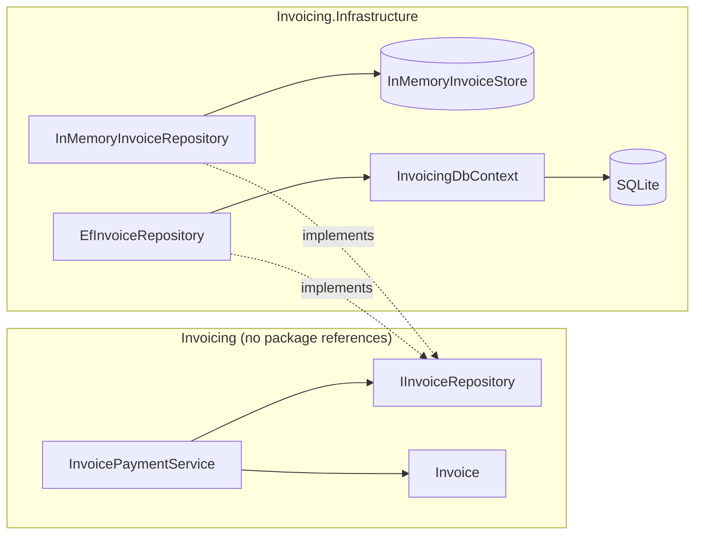

# Specification — 03 Repository Pattern (Invoicing)

An invoice repository that speaks the billing domain's language, a domain project that knows nothing about persistence, and two interchangeable implementations (in-memory and EF Core with SQLite) proven equivalent by one shared contract test suite.

**Date:** 2026-10-07 · **Status:** Implemented. All acceptance criteria pass. This spec was written before any code; since then only this header and section 8 have been added (see [REFACTOR-NOTES.md](REFACTOR-NOTES.md)).

**Living specs:** [invoice-payments](../../openspec/specs/invoice-payments/spec.md) and [invoice-storage](../../openspec/specs/invoice-storage/spec.md) (OpenSpec, since 2026-10-08). From then on this document is a frozen record of the pre-code spec; behaviour changes go to the living specs.

## 1. The concept

A repository makes stored domain objects look like a collection that answers the domain's questions. The application asks "which invoices are overdue as of today?" and gets `Invoice` objects back. It does not know whether they came from SQL, a file, an HTTP API or a dictionary.

**The problem it solves.** Without it, query and save code is spread through the services as `DbContext` or SQL calls. Business rules cannot be tested without a database, the same query gets written in several places, and the domain is tied to one persistence technology.

**What makes it a repository rather than a thin wrapper:**

- **Domain language, not plumbing.** Methods name the questions the domain asks (`ListOverdueAsync(asOf)`). No generic CRUD with `Find(Expression<...>)`, and no `IQueryable<T>`: returning `IQueryable` hands query composition, and every provider quirk, to the callers.
- **Persistence ignorance.** The interface belongs to the domain. Implementations live in an infrastructure project that depends on the domain, never the other way round (dependency inversion). Here the compiler enforces it: the `Invoicing` project has no package references.
- **One contract, several implementations.** "Swappable" is only true if every implementation behaves the same. A shared contract test suite turns that claim into something that is checked.
- **The fake-repository trap.** The obvious in-memory implementation keeps the caller's objects and hands the same objects back. Changing a loaded object then changes "the database" without a save, and a service that forgets to call `UpdateAsync` still passes its tests. A database never behaves like that, so a useful fake stores copies.

**Generic vs specific repositories.** A generic `IRepository<T>` (`GetAll`, `Find(predicate)`, `Add`, `Update`, `Delete`) gives every entity the same shape but carries no domain meaning, and its expression or `IQueryable` members leak the ORM through the abstraction. A specific repository has exactly the queries the domain needs, at the cost of one interface per aggregate and one method per query. This project uses a specific repository.

**"EF Core's `DbContext` already is a repository and a unit of work."** True. `DbSet<T>` is a collection-like abstraction, and `DbContext` tracks changes and commits them together in `SaveChanges`. A repository on top of it adds a layer, hides useful EF features (projections, `Include`, change tracking, transactions) or leaks them anyway, and forces a decision about when changes are saved.

**Costs, and when not to use it:**

- every new query is a new interface method, an implementation per store and a contract test;
- the interface drifts towards the lowest common denominator of its implementations;
- skip it for CRUD-style applications and for read-heavy or reporting queries: use `DbContext` directly (or projections and query objects) and test against SQLite or a real database;
- use it when there are business rules worth unit testing without a database, when queries deserve a name and one home, or when the store may really change (legacy API, document store, cache).

## 2. Problem statement

A small billing module issues invoices to customers. An invoice that is not paid by its due date becomes overdue and must appear on a follow-up list. Payments are recorded against an invoice number. The payment rules must be testable without a database, and the storage technology (EF Core with SQLite today) must be replaceable without touching domain code.

## 3. Scope

**In scope**

- `Invoice` entity with the payment and overdue rules.
- `IInvoiceRepository`, `InvoicePaymentService` and `PaymentResult` in the `Invoicing` project.
- `InMemoryInvoiceRepository` and `EfInvoiceRepository` (with `InvoicingDbContext`) in `Invoicing.Infrastructure`.
- One contract test suite run against both implementations; service tests that use the in-memory implementation.

**Out of scope**

- Issuing invoices as a use case; input validation (blank number, non-positive amount); deleting invoices; partial payments; currencies.
- A unit of work spanning several writes or repositories (each write is saved immediately, see D2).
- The error contract for duplicate numbers and unknown invoices (see D8).
- Migrations (the schema is created with `EnsureCreated`), optimistic concurrency, paging, dependency injection wiring and a host application.

## 4. Requirements

**Business rules**

- **BR-1 Overdue.** An invoice is overdue on date `D` when it is unpaid and `DueDate < D`. The due date is the last day to pay: an invoice due on 2026-10-06 is not overdue on 2026-10-06 and is overdue on 2026-10-07.
- **BR-2 Paid once.** An invoice is paid exactly once. Marking a paid invoice as paid again is an error, and the first payment date is kept.
- **BR-3 Follow-up order.** Overdue invoices are listed oldest due date first. The order of invoices with the same due date is not specified.

**Functional requirements**

- **FR-1** An invoice has an `Id` (a `Guid` assigned by the caller), a `Number`, a `CustomerName`, an `Amount` (`decimal`), a `DueDate` (`DateOnly`) and a `PaidOn` date that is empty until it is paid. `IsPaid` is true exactly when `PaidOn` has a value.
- **FR-2** `Invoice.IsOverdueOn(date)` implements BR-1. `Invoice.MarkPaid(paidOn)` implements BR-2 and throws `InvalidOperationException` when the invoice is already paid.
- **FR-3** `IInvoiceRepository` finds an invoice by id or by number (exact match; `null` when not found), lists the overdue invoices as of a date (BR-1, BR-3), adds a new invoice and updates an existing one.
- **FR-4** Every `AddAsync` and `UpdateAsync` is stored immediately. There is no separate save step.
- **FR-5** Invoices are detached. Changing an invoice object, whether it was passed to `AddAsync` or returned by the repository, has no effect on storage until that object is passed to `UpdateAsync`.
- **FR-6** Both implementations meet FR-3 to FR-5 in the same way and pass the same contract tests.
- **FR-7** `InvoicePaymentService.MarkPaidAsync(invoiceNumber, paidOn)` returns `NotFound` when no invoice has that number, `AlreadyPaid` when the invoice is already paid (stored data unchanged), and otherwise marks the invoice paid on `paidOn`, stores it and returns `Paid`.
- **FR-8** Persistence ignorance: `Invoicing` has no package or project references. Only `Invoicing.Infrastructure` references EF Core.
- **FR-9** EF Core schema: table `Invoices`; key `Id`, never generated by the database; `Number` required, at most 32 characters, unique index; `CustomerName` required, at most 200 characters; `Amount` with precision (18, 2); `DueDate` required; `PaidOn` nullable.

## 5. Design

```csharp
// Invoicing — domain and application code, no persistence references
public sealed class Invoice
{
    public Invoice(Guid id, string number, string customerName, decimal amount, DateOnly dueDate);
    public Guid Id { get; }
    public string Number { get; }
    public string CustomerName { get; }
    public decimal Amount { get; }
    public DateOnly DueDate { get; }
    public DateOnly? PaidOn { get; }          // set only by MarkPaid
    public bool IsPaid { get; }
    public bool IsOverdueOn(DateOnly date);
    public void MarkPaid(DateOnly paidOn);    // InvalidOperationException when already paid
}

public interface IInvoiceRepository
{
    Task<Invoice?> GetByIdAsync(Guid id, CancellationToken cancellationToken = default);
    Task<Invoice?> GetByNumberAsync(string number, CancellationToken cancellationToken = default);
    Task<IReadOnlyList<Invoice>> ListOverdueAsync(DateOnly asOf, CancellationToken cancellationToken = default);
    Task AddAsync(Invoice invoice, CancellationToken cancellationToken = default);
    Task UpdateAsync(Invoice invoice, CancellationToken cancellationToken = default);
}

public enum PaymentResult { Paid, NotFound, AlreadyPaid }

public sealed class InvoicePaymentService(IInvoiceRepository invoices)
{
    public Task<PaymentResult> MarkPaidAsync(string invoiceNumber, DateOnly paidOn, CancellationToken cancellationToken = default);
}

// Invoicing.Infrastructure — references Invoicing and Microsoft.EntityFrameworkCore.Sqlite
public sealed class InMemoryInvoiceStore { }                               // plays the database
public sealed class InMemoryInvoiceRepository(InMemoryInvoiceStore store) : IInvoiceRepository;
public sealed class InvoicingDbContext(DbContextOptions<InvoicingDbContext> options) : DbContext
{
    public DbSet<Invoice> Invoices { get; }
}
public sealed class EfInvoiceRepository(InvoicingDbContext db) : IInvoiceRepository;
```



**How the concept shapes the design**

- The interface sits in the domain project and is named after domain questions. `ListOverdueAsync` returns a materialized `IReadOnlyList<Invoice>`: the query runs inside the repository and callers cannot compose more query on top.
- `InvoicePaymentService` depends only on `IInvoiceRepository` and does not know which implementation it gets.
- The detached-copy semantics (FR-5) were chosen because both implementations can honour them exactly. The in-memory store keeps copies of what it was given and hands out new copies; EF Core reads with `AsNoTracking()`, and every write attaches the invoice and saves. That is what makes the in-memory implementation a faithful stand-in in the service tests.
- Persistence ignorance has a visible price: EF Core needs a constructor whose parameter names match the properties, get-only properties must be mapped explicitly, and queries must say `PaidOn == null` because `IsPaid` is not a column.

**Contract tests.** The abstract class `InvoiceRepositoryContract` holds the repository tests and declares `protected abstract IInvoiceRepository CreateRepository();`. Every call returns a fresh repository over the same underlying store: for in-memory, a new repository over one `InMemoryInvoiceStore`; for EF Core, a new `InvoicingDbContext` over one open SQLite `DataSource=:memory:` connection that lives as long as the test. Tests therefore prove what was stored, not which objects happen to be in memory. `InMemoryInvoiceRepositoryTests` and `EfInvoiceRepositoryTests` (which owns and disposes the connection) inherit every test.

## 6. Acceptance criteria → tests

| AC | Criterion | Test |
|---|---|---|
| AC-1 | An added invoice can be loaded by id and by number from a fresh repository with every field intact (FR-1, FR-3, FR-4). | `AddAsync_ThenLoadFromFreshRepository_ReturnsSameInvoiceByIdAndByNumber` (contract) |
| AC-2 | `ListOverdueAsync(asOf)` returns only unpaid invoices due before `asOf` (not one due on `asOf`, not a paid one, not a future one), oldest due date first (BR-1, BR-3). | `ListOverdueAsync_ReturnsOnlyUnpaidInvoicesPastDueDate_OrderedByDueDate` (contract) |
| AC-3 | Changes to an added or a loaded invoice are not visible to a fresh repository until `UpdateAsync`; after `UpdateAsync` they are (FR-4, FR-5). | `UpdateAsync_PersistsChanges_AndUnsavedChangesAreNotVisible` (contract) |
| AC-4 | Paying an unpaid invoice returns `Paid` and stores the payment date (FR-7). | `MarkPaidAsync_UnpaidInvoice_MarksItPaidAndPersistsIt` |
| AC-5 | Paying an unknown or an already-paid invoice returns `NotFound` or `AlreadyPaid` and leaves the stored invoice unchanged (FR-7, BR-2). | `MarkPaidAsync_UnknownOrAlreadyPaidInvoice_ReturnsFailureAndChangesNothing` (theory, 2 cases) |

That is 5 test methods and 9 test cases: the 3 contract tests run once per implementation (FR-6), plus 1 + 2 service cases. FR-8 is checked by the compiler through project references; FR-9 is exercised by every EF Core contract test, because all of them go through the real schema.

## 7. Assumptions & decisions

- **D1 Specific repository.** One interface with the queries this domain needs; no generic base repository and no `IQueryable`.
- **D2 Save per call.** Each `AddAsync`/`UpdateAsync` saves immediately. That is simple and easy to fake, but several writes cannot be committed atomically. A unit of work (or letting the application call `SaveChanges` itself) is future work.
- **D3 Detached invoices and short-lived repositories.** Returned invoices are copies (FR-5). A repository instance is meant to live for one unit of work, such as one request, like the `DbContext` behind it.
- **D4 Real SQL in tests.** EF Core contract tests use SQLite in-memory, not the EF Core InMemory provider, which is itself a fake: it translates no SQL and enforces no unique index.
- **D5 Results for expected outcomes, exceptions for broken invariants.** The service returns `PaymentResult` for "not found" and "already paid"; the entity throws when asked to break BR-2. The service checks `IsPaid` first, so it never relies on that exception.
- **D6 No clock in the domain.** `asOf` and `paidOn` are passed in, which keeps the rules and the tests deterministic.
- **D7 Caller-assigned ids.** Ids are `Guid`s created by the caller, so an invoice has its identity before it is stored and neither store has to generate keys.
- **D8 Known gap: error cases.** Adding a duplicate number and updating an invoice that was never added are not in the contract yet. EF Core will reject a duplicate number through the unique index; the simplest in-memory implementation will not. This divergence is accepted for now and recorded as a next step.
- **D9 SQLite storage.** SQLite stores `decimal` as text, so `Amount` is never compared or sorted in SQL. `DateOnly` is stored as ISO-8601 text, so `<` and ordering on `DueDate` behave as date comparisons.
- **D10 Exact number matching.** Invoice numbers are compared exactly: ordinal in memory, SQLite's default `BINARY` collation in the database. (SQL Server would compare case-insensitively by default; a contract test would have to pin that down if it mattered.)
- **D11 In-memory scope.** The in-memory implementation is for tests and prototypes. It is not thread-safe, completes synchronously and ignores cancellation.

## 8. Notes after implementation

Facts checked with throwaway probe tests after the code was green. They refine the sections above without changing any requirement.

- **FR-9 on SQLite.** The generated schema stores every column as `TEXT`: `PaidOn` is `NULL`, every other column is `NOT NULL`, and `Number` has the unique index `IX_Invoices_Number`. The lengths (32, 200) and the precision (18, 2) are recorded in the EF Core model, but SQLite does not enforce them; a server database such as SQL Server would.
- **D8 confirmed.** For a duplicate number, EF Core throws `DbUpdateException` and the in-memory repository accepts it. For an update of an unknown invoice, EF Core throws `DbUpdateConcurrencyException` and the in-memory repository inserts it.
- **D3 has a sharper edge than stated.** Reusing one `EfInvoiceRepository` for Add, then Get, then Update throws `InvalidOperationException` (tracking conflict), because `AddAsync` leaves the added object tracked. The in-memory repository allows it. This is idea 3 in the refactor notes.
