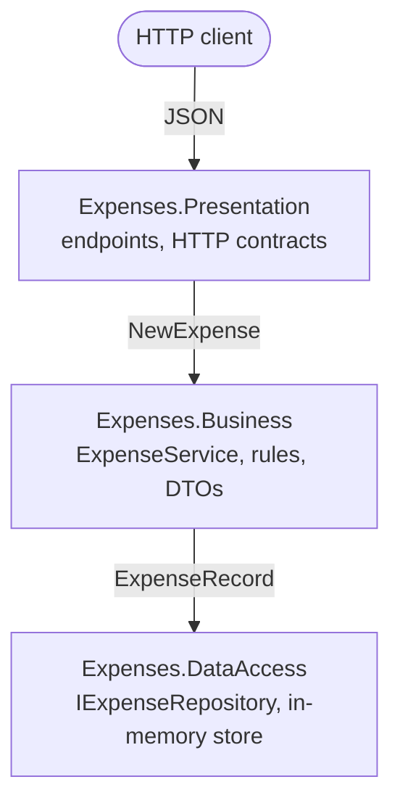

# 04 — Layered Architecture: Specification

Employee expense tracking (submit an expense, get a monthly summary per category) as an ASP.NET Core API
built in three strict layers: Presentation → Business → Data Access.

**Date:** 2026-10-07 · **Status:** Implemented. Written before any code and unchanged since, apart from this
header; the refactor added `ExpenseEndpoints.MapExpenseEndpoints()` (see [REFACTOR-NOTES.md](REFACTOR-NOTES.md)).

**Living spec:** [openspec/specs/expense-tracking/spec.md](../../openspec/specs/expense-tracking/spec.md) (OpenSpec, since
2026-10-08). From then on this document is a frozen record of the pre-code spec; behaviour changes go to the living spec.

## 1. The concept

A *layered architecture* splits an application into horizontal layers, each with one kind of responsibility.
This project uses the classic three:

| Layer | Responsibility | Owns |
|---|---|---|
| Presentation | HTTP: routes, status codes, JSON contracts | request and response records |
| Business | Rules and use cases: validation, summaries | input/output DTOs, `ExpenseCategory`, `ExpenseService` |
| Data Access | Storing and querying data | `ExpenseRecord`, `IExpenseRepository`, the store |

In *strict* layering a layer may use only the layer directly below it; *relaxed* layering also allows skipping
a layer (Presentation calling Data Access). This project is strict. Each layer keeps its own models and
translates ("maps") them at each boundary, so a change to the JSON shape or to the storage format stays inside
one layer.

**The problem it solves.** If one endpoint method parses JSON, checks the rules and writes to storage, the rules
cannot be reused or tested without HTTP, and a storage change ripples through every endpoint. Layers give each
piece of code an obvious home and make the dependency direction predictable: everything points down.

**Costs and trade-offs.**
- Mapping code: one expense exists as three models (HTTP request, business DTO, storage record).
- Pass-through code: for simple reads a layer may do little more than forward the call.
- A feature cuts across all layers, so a typical change touches three projects.
- The main weakness: **the Business layer compiles against Data Access.** `ExpenseService` depends on
  `IExpenseRepository`, which the Data Access project owns. The rules cannot be built or reused without the
  data-access assembly, and storage-shaped interfaces leak upwards.

**Compared with Clean / Onion architecture.** Clean and Onion invert that last dependency: the business core
defines the repository interface it needs and the data-access project implements it, so Data Access depends on
Business and the core depends on nothing. That pays off for rich, long-lived domains, several storage or
integration adapters, or a core that must evolve independently of infrastructure. Classic layering is perfectly
fine, and simpler, for CRUD-style services with one database that is unlikely to change, a domain that closely
mirrors its data, and a team that values a familiar structure.

**When not to use it.** Tiny services and scripts, where the layers are ceremony; systems whose features change
independently, where vertical slices (one folder per feature) fit better; rich domains that need the inversion
described above.

## 2. Problem statement

Employees pay for work-related costs (travel, meals, office supplies, training) and need to record them; finance
wants a monthly total per category. The service is small, but its structure must make it obvious where HTTP
handling, expense rules and storage live, and its dependencies must only point downwards. That rule is enforced
by tests, not by convention.

## 3. Scope

**In scope**
- Submitting an expense over HTTP, with validation.
- A monthly summary per category over HTTP.
- In-memory storage (data is lost when the app stops).
- Unit tests that enforce the layering rules.

**Out of scope**
- Users, authentication, approval workflow, currencies, receipts.
- Reading, changing or deleting a single expense (`GET /expenses/{id}` does not exist; see D-9).
- Persistent storage, OpenAPI/Swagger, custom logging.

## 4. Requirements

**Functional**
- **FR-1 Submit.** A client sends a description, an amount, a category and the date the expense was incurred.
  A valid expense gets a new id, is stored and is returned.
- **FR-2 Validate.** Every business rule (BR-1 to BR-4) is checked and all violations are returned together,
  keyed by field. If any rule fails, nothing is stored.
- **FR-3 Summarise.** For a year and month, return the total and the count per category of the expenses
  incurred in that month, only for categories that have expenses, ordered by total descending (ties: category
  declaration order), plus the grand total. Expenses from other months, including the same month of another
  year, are ignored. A month without expenses has no categories and a grand total of 0.
- **FR-4 HTTP API.**
  - `POST /expenses` returns `201 Created` with `Location: /expenses/{id}` and the created expense, or
    `400 Bad Request` with a validation problem (`application/problem+json`) whose `errors` are keyed by the
    request's JSON property names: `description`, `amount`, `category`, `incurredOn`.
  - `GET /expenses/summary/{year}/{month}` returns `200 OK` with the summary. A month outside 1–12 does not
    match the route (`404 Not Found`).

**Business rules**

| Id | Field | Rule |
|---|---|---|
| BR-1 | Description | Required (not null, empty or whitespace); at most 200 characters. |
| BR-2 | Amount | Greater than 0.00 and at most 5,000.00 (inclusive). |
| BR-3 | IncurredOn | Required (the default date 0001-01-01 counts as missing); not after today, where today is the UTC date of the injected `TimeProvider`. |
| BR-4 | Category | One of Travel, Meals, Office, Training, Other. |

**Architecture rules**
- **AR-1** Presentation references Business and never Data Access (no skip-layer dependency).
- **AR-2** No layer references a layer above it: Business ↛ Presentation, Data Access ↛ Business,
  Data Access ↛ Presentation.
- **AR-3** Each layer has one DI entry point. `AddBusinessLayer()` calls `AddDataAccessLayer()`;
  `Program.cs` calls only `AddBusinessLayer()`.
- **AR-4** Each layer owns its models. The upper layer of each pair does the mapping: Presentation maps
  HTTP ↔ Business, Business maps Business ↔ storage records.

## 5. Design

**Data Access**: `Expenses.DataAccess`, references only `Microsoft.Extensions.DependencyInjection.Abstractions`.
```csharp
public sealed record ExpenseRecord(Guid Id, string Description, decimal Amount, string Category, DateOnly IncurredOn);

public interface IExpenseRepository
{
    Task AddAsync(ExpenseRecord record, CancellationToken cancellationToken = default);
    Task<IReadOnlyList<ExpenseRecord>> ListByMonthAsync(int year, int month, CancellationToken cancellationToken = default);
}

public sealed class InMemoryExpenseRepository : IExpenseRepository; // thread-safe

public static class DataAccessLayerRegistration
{
    public static IServiceCollection AddDataAccessLayer(this IServiceCollection services); // repository as singleton
}
```

**Business**: `Expenses.Business`, references Data Access.
```csharp
public enum ExpenseCategory { Travel = 1, Meals, Office, Training, Other }

public sealed record NewExpense(string Description, decimal Amount, ExpenseCategory Category, DateOnly IncurredOn);
public sealed record Expense(Guid Id, string Description, decimal Amount, ExpenseCategory Category, DateOnly IncurredOn);
public sealed record CategoryTotal(ExpenseCategory Category, decimal Total, int Count);
public sealed record MonthlySummary(int Year, int Month, IReadOnlyList<CategoryTotal> Categories, decimal GrandTotal);

public sealed class SubmitExpenseResult
{
    public bool Succeeded { get; }                                // [MemberNotNullWhen(true, nameof(Expense))]
    public Expense? Expense { get; }
    public IReadOnlyDictionary<string, string[]> Errors { get; } // keys: NewExpense property names
}

public sealed class ExpenseService(IExpenseRepository repository, TimeProvider timeProvider)
{
    public Task<SubmitExpenseResult> SubmitAsync(NewExpense expense, CancellationToken cancellationToken = default);
    public Task<MonthlySummary> GetMonthlySummaryAsync(int year, int month, CancellationToken cancellationToken = default);
}

public static class BusinessLayerRegistration
{
    // Calls AddDataAccessLayer(), adds TimeProvider.System if none is registered, adds a scoped ExpenseService.
    public static IServiceCollection AddBusinessLayer(this IServiceCollection services);
}
```

**Presentation**: `Expenses.Presentation`, ASP.NET Core minimal API, references Business.
```csharp
public sealed record CreateExpenseRequest(string? Description, decimal Amount, string? Category, DateOnly IncurredOn);
public sealed record ExpenseResponse(Guid Id, string Description, decimal Amount, string Category, DateOnly IncurredOn);
public sealed record CategoryTotalResponse(string Category, decimal Total, int Count);
public sealed record MonthlySummaryResponse(int Year, int Month, IReadOnlyList<CategoryTotalResponse> Categories, decimal GrandTotal);

public static class ExpenseEndpoints
{
    public static Task<Results<Created<ExpenseResponse>, ValidationProblem>> PostExpense(
        CreateExpenseRequest request, ExpenseService service, CancellationToken cancellationToken);
    public static Task<Ok<MonthlySummaryResponse>> GetMonthlySummary(
        int year, int month, ExpenseService service, CancellationToken cancellationToken);
}
```

Handlers are public static methods returning `TypedResults`, so a test can call them directly without starting a
web host. `Program.cs` only composes: `AddBusinessLayer()` plus the endpoint mappings.

**Mapping at the boundaries**

| Boundary | What is mapped |
|---|---|
| HTTP → Business | `CreateExpenseRequest` → `NewExpense`. A null description becomes `""`. The category text must equal a category name (case-insensitive); anything else becomes `default(ExpenseCategory)`, which is 0 and not a category, so BR-4 reports it. |
| Business → HTTP | `Expense` → `ExpenseResponse` and `MonthlySummary` → `MonthlySummaryResponse` (category enum → name); error keys such as `IncurredOn` → JSON names such as `incurredOn`. |
| Business → Data Access | `NewExpense` → `ExpenseRecord`: new `Guid`, category enum → name. |
| Data Access → Business | `ExpenseRecord` → `Expense` and summary rows: category name → enum. |



## 6. Acceptance criteria → tests

| AC | Criterion | Test |
|---|---|---|
| AC-1 | Presentation references Business and never Data Access (AR-1). | `ArchitectureTests.Presentation_DoesNotReferenceDataAccess` |
| AC-2 | No layer references a layer above it (AR-2), one case per pair. | `ArchitectureTests.Layers_DoNotReferenceLayersAboveThem` (3 cases) |
| AC-3 | An expense that breaks BR-1 to BR-4 gets one error per broken rule, keyed by field, and nothing is stored (FR-2). | `ExpenseServiceTests.Submit_InvalidExpense_ReturnsValidationErrorsAndStoresNothing` |
| AC-4 | The summary totals and counts per category only the requested year and month, ordered by total descending, with the grand total (FR-3). | `ExpenseServiceTests.GetMonthlySummary_TotalsPerCategoryForRequestedMonthOnly` |
| AC-5 | `POST /expenses` with data the Business layer rejects returns `400` with a validation problem keyed by JSON property names (FR-4). | `ExpenseEndpointsTests.PostExpense_WhenBusinessValidationFails_Returns400ValidationProblem` |

Test doubles are hand-written: `FixedTimeProvider` (overrides `GetUtcNow()`; today is 2026-10-07) and
`SpyExpenseRepository` (records `AddAsync` calls). AC-4 is a *sociable* test: it uses the real
`InMemoryExpenseRepository`, because filtering by month is the repository's job and a fake would only
re-implement it. Not covered by unit tests: the `201 Created` path over HTTP and the summary endpoint's JSON.
They are checked by running the app.

## 7. Assumptions & decisions

- **D-1 Why tests guard the layering.** SDK-style project references are transitive: Presentation sees Data
  Access types through Business, and the compiler would accept `services.AddDataAccessLayer()` in `Program.cs`.
  `Assembly.GetReferencedAssemblies()` lists the assemblies a compiled assembly actually uses, so the tests catch
  exactly that.
- **D-2 Category stored as text.** `ExpenseRecord.Category` holds the category name, not its number, so stored
  data keeps its meaning if the enum is reordered. Data Access does not know the business enum; Business maps it.
- **D-3 Categories start at 1.** `default(ExpenseCategory)` (0) is never a category, so an unset or unknown
  category fails BR-4 instead of silently becoming Travel.
- **D-4 No `Enum.TryParse` for HTTP input.** It also accepts numbers (`"3"`) and comma lists (`"Travel, Meals"`
  is 1 | 2 = Office), so Presentation matches category names only.
- **D-5 Today** is the UTC date of `TimeProvider.GetUtcNow()`; expense dates are `DateOnly`, without time zones.
- **D-6 Money** is `decimal` in one implicit currency, with no rule on decimal places.
- **D-7 Ids** are `Guid`s generated by Business.
- **D-8 Storage** is a singleton list guarded by a `System.Threading.Lock`. The repository and the service are
  async and take a `CancellationToken`, as real data access would.
- **D-9 Location header.** `201 Created` points to `/expenses/{id}` by convention, although that endpoint is out
  of scope.
- **D-10 Validation is not fail-fast.** All rules run so a client can fix everything at once; each field gets at
  most one message. Business keys errors by `NewExpense` property names; Presentation renames them to the JSON
  names the client used.
- **D-11 Malformed JSON** (for example `"amount": "abc"`) is rejected by ASP.NET Core before the handler runs;
  that `400` does not use the error keys above.
- **D-12 Summary input.** Business does not validate `year` and `month`: an impossible month simply has no
  expenses, and the HTTP route only accepts months 1–12.
