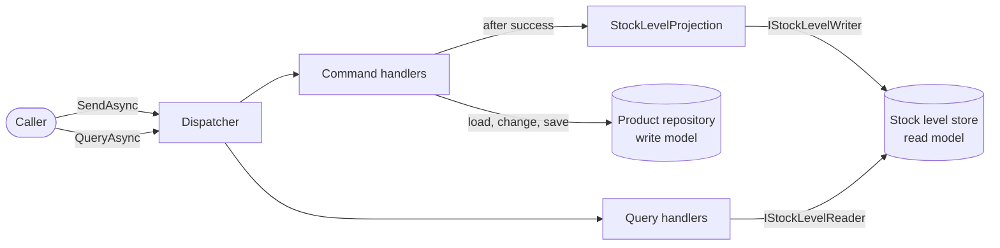

# 05 — CQRS basics: warehouse stock

Specification for a small stock-keeping module that separates commands (change stock) from queries (read stock), each with its own model.

**Date:** 2026-10-07 · **Status:** Implemented. Written before any code; afterwards only BR-3 and D-2 were clarified (receive and ship check the SKU before the quantity). Internal helpers added while refactoring are described in [REFACTOR-NOTES.md](REFACTOR-NOTES.md).

**Living spec:** [openspec/specs/warehouse-stock/spec.md](../../openspec/specs/warehouse-stock/spec.md) (OpenSpec, since 2026-10-08). From then on this document is a frozen record of the pre-code spec; behaviour changes go to the living spec.

## 1. The concept

CQRS (Command Query Responsibility Segregation) splits a module into two halves with different jobs:

- The **write side** accepts *commands* such as "ship 8 of BOLT-M6". A command changes state and reports only whether it worked; it returns no data.
- The **read side** answers *queries* such as "how many BOLT-M6 are on hand?". A query returns data and never changes state.

Each half has its own model. The write model is shaped to protect business rules: an aggregate that refuses to let stock go negative. The read model is shaped for the screens: flat rows with values already computed. A **projection** copies every successful change from the write model into the read model.

The idea is Bertrand Meyer's command-query separation (a method either changes state or returns data, never both) applied to whole models instead of single methods.

**The problem it solves.** With one model for both jobs, the same class must guard the rules and feed every screen. Screens pull extra getters, computed properties and query logic into the domain class, and code that "only needs to read" ends up loading, and sometimes changing, the aggregate. With two models each side stays simple for its own job, and the read side can be optimised (precomputed flags, denormalised rows, later its own database) without touching the rules.

**Costs and trade-offs.**

- More types: a message and a handler for every operation, plus a dispatcher. Simple reads become thin pass-through handlers.
- The models must be kept in sync. Here that is one synchronous call. With separate stores it becomes asynchronous and the read side lags behind the write side (eventual consistency), which screens and users must tolerate.
- Data is stored twice, and the dispatcher adds indirection that makes call chains harder to follow.

**When not to use it.** Plain CRUD, where screens show exactly what was saved; small modules with few rules; teams that cannot yet explain stale reads to users. CQRS is usually applied to the one part of a system with real read/write asymmetry, not to a whole application.

**CQRS is not event sourcing.** Event sourcing stores state as a log of events and rebuilds it by replaying them. CQRS only separates the read and write models. The two are often combined because events are a convenient feed for projections, but this module stores current state only. CQRS does not require two databases either: here both models live in memory in one process.

## 2. Problem statement

A small warehouse tracks stock per product, identified by a SKU. Operators register products, book incoming deliveries (receive) and book outgoing shipments (ship). Two screens read the data:

- **Stock lookup** shows the stock level of one SKU.
- **Reorder list** shows every product at or below its reorder level, emptiest first, so the buyer knows what to order.

Stock must never go negative, and one SKU must identify exactly one product.

## 3. Scope

**In scope:** three commands (register, receive, ship); two queries (stock level, low-stock list); the `Product` aggregate with an in-memory repository; the `StockLevelView` read model with an in-memory store; a synchronous projection; a hand-written dispatcher on top of `Microsoft.Extensions.DependencyInjection`; the DI registration (`AddInventory`).

**Out of scope:** a database, or a separate read store fed asynchronously (the natural next step, and the point where eventual consistency appears); domain events and event sourcing; concurrency control for simultaneous commands on one SKU; editing or deleting products; several warehouses; units of measure; an HTTP API or UI; pipeline behaviours such as logging or validation decorators.

## 4. Requirements

| ID | Requirement |
|---|---|
| FR-1 | `RegisterProduct(Sku, Name, ReorderLevel)` creates a product with 0 on hand. It fails if the SKU is already registered. |
| FR-2 | `ReceiveStock(Sku, Quantity)` adds `Quantity` to the quantity on hand. It fails if the SKU is not registered. |
| FR-3 | `ShipStock(Sku, Quantity)` subtracts `Quantity`. It fails if the SKU is not registered or `Quantity` is more than is on hand. |
| FR-4 | Every command returns a `CommandResult`: success with no data, or failure with one error message. A failed command changes nothing on either side. |
| FR-5 | After every successful command the product's `StockLevelView` row is created or replaced before the command returns, so the next query sees the change. |
| FR-6 | `GetStockLevel(Sku)` returns the product's row, or `null` if the SKU is not registered. |
| FR-7 | `GetLowStockProducts()` returns every row with `IsLowStock = true`, ordered by quantity on hand ascending, then by SKU. |
| FR-8 | Queries never change state, and query handlers depend only on the read model's reader interface. |
| FR-9 | The dispatcher routes each command and query to its single registered handler; a message without a handler throws `InvalidOperationException`. |

**Business rules**

- **BR-1 Low stock:** `IsLowStock = QuantityOnHand <= ReorderLevel`. With reorder level 10, 10 on hand is low and 11 is not.
- **BR-2 No negative stock:** a new product starts at 0 (so it is low stock until enough is received), and shipping never takes the quantity below 0.
- **BR-3 Well-formed input:** when registering, SKU and name are not blank and the reorder level is at least 0; receive and ship quantities are at least 1.
- **BR-4 SKU identity:** SKUs are compared ordinal and case-insensitive (`BOLT-M6` equals `bolt-m6`). The casing used at registration is the one stored and shown.

**Failure messages** (exact text of `CommandResult.Error`)

| Situation | Message |
|---|---|
| SKU already registered | `Product 'BOLT-M6' is already registered.` (casing as registered) |
| SKU not registered | `Product 'BOLT-M6' is not registered.` |
| Shipping more than is on hand | `Cannot ship 8 of 'BOLT-M6': only 5 on hand.` |

Breaking BR-3 is a caller error, not a business outcome: it throws `ArgumentException` (see D-2). Receive and ship look the SKU up first, so an unknown or blank SKU fails as not registered before the quantity is checked.

## 5. Design

Public API by folder and namespace. Constructor dependencies are shown in the class header for brevity.

```csharp
// Inventory.Abstractions: the CQRS contracts both sides share
public interface ICommand;                         // marker
public interface IQuery<TResult>;                  // marker; TResult gives callers a typed result
public interface ICommandHandler<TCommand> where TCommand : ICommand
{
    Task<CommandResult> HandleAsync(TCommand command, CancellationToken cancellationToken);
}
public interface IQueryHandler<TQuery, TResult> where TQuery : IQuery<TResult>
{
    Task<TResult> HandleAsync(TQuery query, CancellationToken cancellationToken);
}
public sealed record CommandResult                 // private constructor: only the factories create it
{
    public bool IsSuccess { get; }
    public string? Error { get; }
    public static CommandResult Success();
    public static CommandResult Failure(string error);
}
public interface IDispatcher
{
    Task<CommandResult> SendAsync<TCommand>(TCommand command, CancellationToken cancellationToken = default)
        where TCommand : ICommand;
    Task<TResult> QueryAsync<TResult>(IQuery<TResult> query, CancellationToken cancellationToken = default);
}

// Inventory.Dispatching
public sealed class Dispatcher(IServiceProvider services) : IDispatcher;

// Inventory.WriteSide: commands, the aggregate and everything that changes it
public sealed record RegisterProduct(string Sku, string Name, int ReorderLevel) : ICommand;
public sealed record ReceiveStock(string Sku, int Quantity) : ICommand;
public sealed record ShipStock(string Sku, int Quantity) : ICommand;
public sealed class Product
{
    public Product(string sku, string name, int reorderLevel);   // 0 on hand
    public string Sku { get; }
    public string Name { get; }
    public int ReorderLevel { get; }
    public int QuantityOnHand { get; }                           // private setter
    public void Receive(int quantity);
    public CommandResult Ship(int quantity);                     // fails instead of going negative
}
public interface IProductRepository
{
    Task<Product?> FindAsync(string sku, CancellationToken cancellationToken);
    Task SaveAsync(Product product, CancellationToken cancellationToken);
}
public sealed class InMemoryProductRepository : IProductRepository;
public sealed class StockLevelProjection(IStockLevelWriter writer)
{
    public Task ProjectAsync(Product product, CancellationToken cancellationToken);
}
public sealed class RegisterProductHandler(IProductRepository products, StockLevelProjection projection)
    : ICommandHandler<RegisterProduct>;          // ReceiveStockHandler, ShipStockHandler: same dependencies

// Inventory.ReadSide: queries, the read model and its store
public sealed record GetStockLevel(string Sku) : IQuery<StockLevelView?>;
public sealed record GetLowStockProducts : IQuery<IReadOnlyList<StockLevelView>>;
public sealed record StockLevelView(string Sku, string Name, int QuantityOnHand, int ReorderLevel, bool IsLowStock);
public interface IStockLevelReader
{
    Task<StockLevelView?> FindAsync(string sku, CancellationToken cancellationToken);
    Task<IReadOnlyList<StockLevelView>> ListLowStockAsync(CancellationToken cancellationToken);
}
public interface IStockLevelWriter
{
    Task UpsertAsync(StockLevelView view, CancellationToken cancellationToken);
}
public sealed class InMemoryStockLevelStore : IStockLevelReader, IStockLevelWriter;
public sealed class GetStockLevelHandler(IStockLevelReader reader) : IQueryHandler<GetStockLevel, StockLevelView?>;
public sealed class GetLowStockProductsHandler(IStockLevelReader reader)
    : IQueryHandler<GetLowStockProducts, IReadOnlyList<StockLevelView>>;

// Inventory
public static class ServiceCollectionExtensions
{
    public static IServiceCollection AddInventory(this IServiceCollection services);
}
```

How CQRS shapes the design:

- **Two models.** `Product` is the write model: state changes only through methods that enforce the rules. `StockLevelView` is the read model: an immutable row with `IsLowStock` already computed, so the reorder screen needs no logic.
- **Commands return no data.** `RegisterProduct` does not return the product; the caller chose the SKU and can query it.
- **Command flow:** load the product, let it change itself, save it, project it, return `Success()`. On failure nothing is saved or projected.
- **Query flow:** handler, then `IStockLevelReader`, then rows. No aggregate and no rules, only lookup, filter and sort.
- **Interface segregation on the read store.** One `InMemoryStockLevelStore` implements `IStockLevelReader` (for query handlers) and `IStockLevelWriter` (for the projection only). It is one singleton exposed through both interfaces, so both see the same data.
- **Dependencies point one way.** `ReadSide` depends only on `Abstractions`. `WriteSide` reaches the read model only through the projection (`IStockLevelWriter`, `StockLevelView`). Query handlers never see `Product` or `IProductRepository`.
- **Dispatcher.** `SendAsync` resolves `ICommandHandler<TCommand>` from the command's compile-time type. `QueryAsync` only receives an `IQuery<TResult>`, so it builds `IQueryHandler<TQuery, TResult>` from the query's runtime type; this is the one place that needs reflection. The empty `IQuery<TResult>` lets the compiler infer the result type: `await dispatcher.QueryAsync(new GetStockLevel("BOLT-M6"))` is a `StockLevelView?`.
- **Lifetimes.** Stores are singletons (they hold the data); handlers, the projection and the dispatcher are stateless and transient.



## 6. Acceptance criteria and tests

| AC | Criterion | Test |
|---|---|---|
| AC-1 | BOLT-M6 ("Hex bolt M6", reorder level 10) with 25 on hand receives 15 more: the command succeeds and `GetStockLevel("BOLT-M6")` returns `(BOLT-M6, Hex bolt M6, 40, 10, IsLowStock: false)`. All calls go through `IDispatcher` from the real container. (FR-2, FR-5, FR-6, FR-9) | `ReceiveStock_ThenGetStockLevel_ReturnsUpdatedQuantity` |
| AC-2 | With 5 on hand, shipping 8 fails with `Cannot ship 8 of 'BOLT-M6': only 5 on hand.`, and both the write model (repository) and the read model (query) still show 5. (FR-3, FR-4, BR-2) | `ShipStock_MoreThanOnHand_FailsAndLeavesStockUnchanged` |
| AC-3 | Given BOLT-M6 (11 on hand, reorder level 10), NUT-M6 (10/10), WASHER-M6 (3/20 after receiving 30 and shipping 27) and SCREW-M4 (0/5, nothing received), the low-stock list is exactly SCREW-M4, WASHER-M6, NUT-M6, as full rows. (FR-5, FR-7, BR-1) | `GetLowStockProducts_ReturnsProductsAtOrBelowReorderLevel_LowestQuantityFirst` |
| AC-4 | With BOLT-M6 registered, registering `BOLT-M6` or `bolt-m6` again fails with `Product 'BOLT-M6' is already registered.` and the original row is unchanged. (FR-1, FR-4, BR-4) | `RegisterProduct_DuplicateSku_Fails` (theory, 2 cases) |
| AC-5 | Every class in the Inventory assembly that implements `IQueryHandler<,>` takes only `IStockLevelReader` in its constructors: no repository, no writer, no projection. (FR-8) | `QueryHandlers_DependOnlyOnTheReadModel` |

Deliberately not covered by the five tests: unknown SKU (FR-2, FR-3), the BR-3 guards, the SKU tie-break (FR-7) and a missing handler (FR-9).

## 7. Assumptions and decisions

- **D-1 SKU comparison.** `StringComparer.OrdinalIgnoreCase` in both stores. People type SKUs, and two products that differ only in casing would be a data-quality bug. Ordinal comparison avoids culture-specific casing rules.
- **D-2 Failure result or exception.** A well-formed command that the current state does not allow (duplicate SKU, unknown SKU, not enough stock) returns `CommandResult.Failure`. A malformed command (blank SKU or name on registration, negative reorder level, quantity below 1, a `null` command) throws `ArgumentException`: an API layer validates input before dispatching, and the aggregate's guard clauses stay the only place these rules live.
- **D-3 Synchronous projection.** Command handlers call the projection after saving, so a query right after a command sees the change. A separate read store updated asynchronously (outbox, message bus) is the next step and out of scope; commands and queries would keep their shape, but reads could briefly lag.
- **D-4 Hand-written dispatcher instead of MediatR.** A few dozen lines on top of `IServiceProvider`. Writing it shows what a mediator library does (map a message type to a handler type and resolve it from DI) and avoids a third-party dependency.
- **D-5 Commands are routed by compile-time type.** A command held in a variable of type `ICommand` would look for `ICommandHandler<ICommand>` and fail. Callers always pass the concrete record, so this is accepted.
- **D-6 In memory, one process.** Stores use `ConcurrentDictionary`; two commands changing the same product at the same moment are not protected (no optimistic concurrency).
- **D-7 Tests use the real composition.** The in-memory stores are fast and deterministic, so tests build the real container (`AddInventory`, with `ValidateOnBuild` and `ValidateScopes`) instead of hand-written doubles; this also checks the DI wiring. The architecture test only uses reflection.
