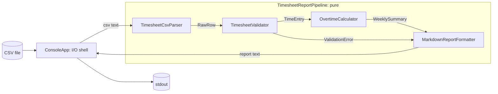

# 06 — Separation of Concerns: weekly timesheet overtime report

Turn a time-tracking CSV export into a Markdown overtime report for payroll, with reading, parsing, validation, calculation, presentation and orchestration each in its own unit.

- **Date:** 2026-10-07
- **Status:** Implemented — written before any code; afterwards only this header changed
- **Living spec:** [openspec/specs/timesheet-report/spec.md](../../openspec/specs/timesheet-report/spec.md) (OpenSpec, since 2026-10-08). From then on this document is a frozen record of the pre-code spec; behaviour changes go to the living spec.

## 1. The concept

**Separation of Concerns (SoC)** means splitting a program so that each part deals with one concern — one kind of knowledge or decision — and knows as little as possible about how the other parts do their work. A practical test for "is this a separate concern?" is whether it changes for its own reasons: the input source, the CSV dialect, the input rules, the payroll rule and the report layout all change independently of each other.

**The problem it solves.** When concerns are tangled, every change edits the same code, a bug in one concern hides behind the others, and nothing can be tested without setting up everything at once (a real file, a console, the machine's culture).

**SoC and SRP.** SoC applies at every scale: layers (UI, domain, data), modules (here: a pure core library and a console shell), classes (one class per concern) and functions (one method per rule). The Single Responsibility Principle is its class-level form: a class should have one reason to change.

**Costs and trade-offs.**

- More types and files: ten small types here, where a script would have one method.
- Indirection: following one row from file to report means opening several files.
- The records passed between units (`RawRow`, `TimeEntry`, `WeeklySummary`) are contracts; changing one touches both sides.
- Badly placed boundaries cost more than none: a class for a trivial step adds ceremony without isolating any change.

**When not to use it.** A throwaway script, a one-off data fix or a prototype: the tangled 30-line version is cheaper. Separate when the code needs tests, will keep changing, or must be reused (for example the same calculation behind a web upload).

**Shape used here: functional core, imperative shell.** All I/O (files, console, exit codes) lives in a thin "humble" console app with no logic worth testing. Everything else is pure functions from values to values, so the tests need no files, mocks or fakes.

## 2. Problem statement

Payroll receives a weekly CSV export (`employee,date,hours`) from the time-tracking tool. They need, per employee and ISO week, the total, regular and overtime hours, plus a list of rows that could not be used and why.

The tangled version this project replaces:

```csharp
var totals = new Dictionary<string, decimal>();
foreach (var line in File.ReadAllLines(args[0]).Skip(1))
{
    var parts = line.Split(',');
    var date = DateTime.Parse(parts[1]);  // the first bad row throws, without a line number
    var hours = decimal.Parse(parts[2]);  // current culture: "7.5" is 75 on a bs-Latn-BA machine
    var week = CultureInfo.CurrentCulture.Calendar.GetWeekOfYear(
        date, CalendarWeekRule.FirstFourDayWeek, DayOfWeek.Monday); // 2025-12-29 gives 53; ISO says 2026-W01
    var key = $"{parts[0]} week {week}";
    totals[key] = totals.GetValueOrDefault(key) + hours;
}
foreach (var (key, total) in totals)
    Console.WriteLine($"{key}: {total} h, overtime {Math.Max(0, total - 40)} h"); // "42,5" on that machine
```

What goes wrong:

- **Untestable without files:** a test needs a real file and has to capture the console.
- **Culture bugs:** parsing and printing follow the machine's culture. In Bosnian, `.` is the thousands separator, so `7.5` silently becomes 75 hours.
- **One bad row stops the import,** and the message does not say which line.
- **Wrong weeks:** the calendar week is not the ISO week, so the week around New Year is split in two, and the key has no year.
- **Every change touches everything:** a new report column, a new validation rule and a new input source all edit the same loop.

## 3. Scope

**In scope:** CSV text to a Markdown report per employee and ISO week; row validation with line numbers (invalid rows are reported, not fatal); a console app that reads a file and prints the report.

**Out of scope:** quoted fields and escaped commas; other delimiters; daily overtime, holidays, pay rates and per-contract thresholds; cross-row checks (duplicate rows, more than 24 h per day across rows); escaping Markdown characters such as `|` in names; a localised report; writing the report to a file (redirect stdout instead).

## 4. Requirements

### Parsing

- **FR-1** Line breaks are LF or CRLF. Lines are numbered by physical position from 1 (header = line 1). Blank and whitespace-only lines are skipped but still counted.
- **FR-2** Line 1 must be the header `employee,date,hours`, compared field by field after trimming and ignoring letter case. Otherwise parsing throws `FormatException` with the message `Line 1 must be the header 'employee,date,hours'.`
- **FR-3** Every other non-blank line becomes a `RawRow`: the line split on `,`, each field trimmed. The parser does not judge the number or the content of the fields.

### Validation

- **FR-4** Each row is checked against these rules in order. The first rule that fails gives the row's only `ValidationError(LineNumber, Message)`:

  | # | Rule | Message (exact) |
  |---|---|---|
  | 1 | exactly 3 fields | `Expected 3 fields but found {count}.` |
  | 2 | employee is not empty | `Employee is missing.` |
  | 3 | date has the exact format `yyyy-MM-dd` and exists | `Date '{field}' is not a valid yyyy-MM-dd date.` |
  | 4 | hours is digits with an optional `.` and decimals (optional leading sign) | `Hours '{field}' is not a number.` |
  | 5 | 0 < hours ≤ 24 | `Hours '{field}' must be greater than 0 and at most 24.` |

  `{field}` is the trimmed field text, so messages never depend on culture. A leading sign is accepted only so that `-3` gets the more useful range message.
- **FR-5** A row that passes all rules becomes `TimeEntry(Employee, Date, Hours)`. Entries and errors keep input order; invalid rows are excluded from the calculation.

### Calculation

- **FR-6** Entries are grouped by employee and ISO 8601 week, using `ISOWeek.GetYear` and `ISOWeek.GetWeekOfYear`. Weeks start on Monday; a week can span two months or two years (2025-12-29 is in 2026-W01).
- **FR-7** Employee names are matched with `StringComparer.OrdinalIgnoreCase`; a summary shows the first spelling in input order.
- **FR-8** Per employee and week: Total = sum of hours (exact decimal arithmetic, no rounding); Regular = min(Total, 40); Overtime = max(0, Total − 40).
- **FR-9** Summaries are ordered by employee (`OrdinalIgnoreCase`), then ISO year, then ISO week.

### Report

- **FR-10** The report has exactly this layout. Every line ends with `\n`, including the last one:

  ```text
  # Overtime report

  ## Weekly hours

  | Employee | Week | Total | Regular | Overtime |
  |---|---|---:|---:|---:|
  | Ana Kovac | 2026-W40 | 42.50 | 40.00 | 2.50 |

  ## Rejected rows

  - Line 8: Expected 3 fields but found 4.
  ```

- **FR-11** One table row per summary, in the order given. Week is `{ISO year}-W{week as two digits}` (`2026-W05`); hours use the format `0.00` with the invariant culture (rounding is for display only). With no summaries the table keeps only its two header lines.
- **FR-12** One `- Line {n}: {message}` line per error, in the order given. With no errors the section holds the single line `None.`

### Orchestration and console app

- **FR-13** `TimesheetReportPipeline.Run(csvText)` parses, validates, calculates the valid entries and formats the summaries together with the errors. It is pure (no I/O, no clock, no dependence on the current culture); the `FormatException` from FR-2 propagates.
- **FR-14** The console app reads the file named by the first argument (default: `samples/timesheet-sample.csv`, copied next to the executable), writes the report to stdout and exits with 0. A missing file gives a message on stderr and exit code 1; a file without the header (FR-2) gives a message on stderr and exit code 2.

## 5. Design

Each concern is one unit with one reason to change:

| Concern | Unit | Knows about | Changes when |
|---|---|---|---|
| Reading input | `Timesheets.ConsoleApp` | paths, file reading, stdout and stderr, exit codes | the input source or output channel changes |
| Parsing | `TimesheetCsvParser` | lines, commas, the header, trimming | the CSV dialect changes |
| Validation | `TimesheetValidator` | field order, formats, limits, messages | the input rules change |
| Calculation | `OvertimeCalculator` | ISO weeks, the 40-hour rule | the payroll rule changes |
| Presentation | `MarkdownReportFormatter` | Markdown layout, number display | the report layout changes |
| Orchestration | `TimesheetReportPipeline` | the order of the steps | a step is added or removed |



Public API (namespace `Timesheets`, one type per file):

```csharp
public sealed record RawRow(int LineNumber, IReadOnlyList<string> Fields);
public sealed record TimeEntry(string Employee, DateOnly Date, decimal Hours);
public sealed record ValidationError(int LineNumber, string Message);
public sealed record ValidationResult(IReadOnlyList<TimeEntry> Entries, IReadOnlyList<ValidationError> Errors);
public sealed record WeeklySummary(string Employee, int IsoYear, int IsoWeek,
    decimal TotalHours, decimal RegularHours, decimal OvertimeHours);

public static class TimesheetCsvParser { public static IReadOnlyList<RawRow> Parse(string csvText); }
public static class TimesheetValidator { public static ValidationResult Validate(IEnumerable<RawRow> rows); }
public static class OvertimeCalculator { public static IReadOnlyList<WeeklySummary> Calculate(IEnumerable<TimeEntry> entries); }
public static class MarkdownReportFormatter
{
    public static string Format(IReadOnlyList<WeeklySummary> summaries, IReadOnlyList<ValidationError> errors);
}
public static class TimesheetReportPipeline { public static string Run(string csvText); }
```

How the concept shapes the design:

- **Units are connected by data, not by calls.** Each unit's output is the next unit's input, and only the pipeline calls the others. The formatter never sees a `RawRow`; the calculator never sees a line number or a string to parse.
- **Static classes, on purpose.** Each unit is a pure function with no state and nothing worth replacing in a test, so a static class is the simplest honest shape. SoC does not need interfaces or a DI container: the tests call the real units with plain values. If a unit later needs configuration (a threshold per contract) or a runtime choice (an HTML formatter), it can become an instance class behind an interface; the pipeline is its only caller.
- **Two kinds of errors.** A bad row is expected data: it becomes a `ValidationError` and the import continues. A missing header means the text is not a timesheet export at all: an exception, which the shell turns into exit code 2.
- **Culture is decided in two places only:** the validator parses with `CultureInfo.InvariantCulture` and the formatter formats with it. No other unit converts between text and numbers or dates.

## 6. Acceptance criteria → tests

| AC | Criterion | Test |
|---|---|---|
| AC-1 | FR-1 to FR-3: the header (in any letter case) and blank or whitespace-only lines are skipped, rows keep their physical line numbers, fields are trimmed, and a row with too few fields is passed on unjudged. | `TimesheetCsvParserTests.Parse_SkipsHeaderAndBlankLines_AndKeepsPhysicalLineNumbers` |
| AC-2 | FR-4, FR-5: every invalid row gives exactly one error with its line number and the message of the first failing rule (one row per rule, plus a row that breaks three rules); valid rows, including the 24-hour limit, come through as typed `TimeEntry` values. | `TimesheetValidatorTests.Validate_InvalidRows_AreRejectedWithLineNumberAndReason` |
| AC-3 | FR-6 to FR-9: from unordered entries (one employee in two ISO weeks, one of which runs from December 2025 into January 2026, and a name written in two letter cases) the result has one summary per employee and week, at most 40 regular hours with the rest as overtime, in the required order. | `OvertimeCalculatorTests.Calculate_HoursAbove40PerIsoWeek_AreOvertime` |
| AC-4 | FR-10 to FR-12: summaries and errors render to exactly the specified Markdown, including a two-digit week (`2026-W05`) and two-decimal hours. | `MarkdownReportFormatterTests.Format_RendersSummaryTableAndRejectedRows` |
| AC-5 | FR-13: CSV text with valid and invalid rows becomes the complete expected report, also when the current culture is `bs-Latn-BA` (decimal comma). | `TimesheetReportPipelineTests.Run_CsvWithValidAndInvalidRows_ProducesCompleteReport` |

The suite is limited to five tests, so three rules have no test of their own: the header `FormatException` (FR-2), the `None.` line (FR-12) and the console app (FR-14). The console app is kept so thin that a manual run is enough; it is recorded in the README.

## 7. Assumptions & decisions

- **Names match case-insensitively** (FR-7): for payroll, splitting one person's week into two rows could hide overtime (30 h + 15 h shows none). Accents are not folded: `Hadžić` and `Hadzic` stay two employees.
- **Ordinal ordering**, not culture-aware sorting, so the order is the same on every machine (a side effect: `Č` sorts after `Z`).
- **The header must be line 1.** Tool exports never start with a blank line; anything else is not a timesheet export.
- **Several rows for the same employee and date are allowed** and added up (split shifts); a daily limit across rows is out of scope.
- **Hours may have more than two decimals.** The calculation is exact; only the report rounds.
- **One 40-hour threshold for everyone,** as given by payroll for this scope.
- **The report uses `\n` line endings on every OS,** so the output is identical everywhere and the tests can compare exact strings.
- **The shell reads with `File.ReadAllText`** (UTF-8, byte-order mark detected); the core only ever sees a `string`.
